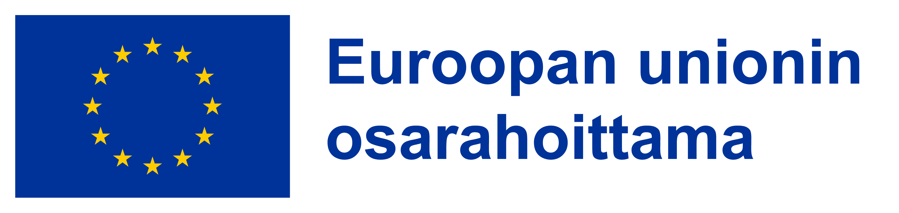

# Työkalu matkailutulo- ja profiilimallinnukseen

<b>Työkalun käyttöohjeet</b>

<em>Viimeisin päivitys: 3.3.2026</em>

<b>Sisällysluettelo</b>

<nav class="toc">
  <ul>
    <li><a href="#intro">Johdanto</a></li>
    <li><a href="#data_and_model">Data ja laskentamalli</a></li>
    <li><a href="#usage">Käyttö</a></li>
    <li><a href="#implementation">Toteutus</a></li>
    <li><a href="#references">Lähteet</a></li>
</nav>

<section id="intro">
  <h1>Johdanto</h1>
  

<b>Mitä työkalu tekee?</b>

Tätä laskentatyökalua voidaan käyttää ennustamaan kansainvälisten matkailijoiden rahankäyttöä hyödyntäen Matkailijamittari dataa (Visit Finland, 2026). Ennustemallilla voidaan arvioida matkailijan keskimääräistä rahankäyttöä valitun profiilin suhteen sekä simuloida yksittäisiä skenaarioita matkailijoiden rahankäyttöön liittyen.

  <b>Kenelle ja mihin työkalu on tarkoitettu?</b>

Työkalua voivat käyttää kaikki matkailun tiedolla johtamista harjoittavat, jotka ovat kiinnostuneita matkailijoiden rahankäytöstä ja kulutuskäyttäytymiseen liittyvien skenaarioiden tarkastelusta. Laskentamalli antaa mahdollisuuden
<ul>
  <li>
  Matkailijoiden rahankäytön ennustamiseen erilaisten tekijöiden suhteen, keskimääräisissä tapauksissa, sekä yksittäisissä realisaatioissa.
  </li>
  <li>
  Rahankäytön vertailuun erilaisten matkailijaprofiilien välillä.
  </li>
  <li>
  Rahankäyttöön liittyvän epävarmuuden tarkasteluun.
  </li>
</ul>

</section>

<section id="data_and_model">
  <h1>Data ja laskentamalli</h1>

Työkalun datana hyödynnetään avoimesti saatavilla olevaa Matkailijamittari-dataa (Avoindata.fi, 2026). Laskentamallia on jalostettu matkailijan rahankäytön ennustamista käsittelevän artikkelin pohjalta (Valkonen & Koskela, 2025), jossa rahankäytön ennustemallinnusta on kuvattu kokonaisvaltaisemmin. Työkalu hyödyntää Bayes-mallia, johon on käytetty R-ohjelman (R Core Team, 2023) brms-pakettia (Bürkner, 2017). Käyttöliittymän rakentamiseen on hyödynnetty Shiny-kirjastoa (Chang ym., 2022). 

  

Kausaalisia tulkintoja tekijöiden vaikutuksista ei työkalulla voida suoraan tehdä. Toisin sanoen, ei voida sanoa esimerkiksi, että yhden yön pidempi matka <em>aiheuttaa</em> x euroa enemmän kulutusta. Kausaalisuuteen ja kausaalivaikutuksiin Matkailijamittari-datan kontekstissa, erityisesti yöpymisen osalta, on paneuduttu artikkelissa (Valkonen & Karvanen, 2026)

</section>

<section id="usage">
  <h1>Käyttö</h1>
  
  
<b>Ennustettavan profiilin valinta</b>

  
  
Profiilin valintaan käytetään vasemmalla olevaa <em>Profiili</em>-palkkia, sekä tämän vieressä oikealla olevaa <em>Valitse datassa havaituista profiileista</em> -taulukkoa.

  
  

  
  
Vasemmalla oleva <em>Profiili</em>-palkki sisältää kaikki valittavissa olevat rahankäyttöön vaikuttavat tekijät ja näiden määrityksen. Klikkaamalla halutun tekijän kohdalta vetovalikosta, voidaan kyseiselle tekijälle määritellä haluttu arvo.

  
Profiilin täydentämiseen voidaan hyödyntää oikealla puolella olevaa taulukkoa <em>Valitse datassa havaituista profiileista</em>, joka hyödyntää datassa havaittuja profiileja. <em>Haku</em>-palkkia voidaan käyttää vapaamuotoiseen etsimiseen taulukosta.
  

Edellä mainitussa taulukossa profilointi on tehty sarakkeissa olevien tekijöiden suhteen ja kyseisten profiilien datassa havaitut kokonaismäärät on esitetty taulukon sarakkeessa <em>Havaintojen lukumäärä</em>. Klikkaamalla kyseisen havainnon riviä, profiilin valinnat täydentyvät <em>Profiili</em>-palkkiin automaattisesti. Halutessa profiilin valintoja voidaan täydentää itsenäisesti valitsemalla suoraan <em>Profiili</em>-palkissa olevista vetovalikoista.

<em>Profiili</em>-taulukon <em>Matkailijoita</em>-syötteessä voidaan asettaa haluttu matkailijamäärä tarkasteluun.

HUOM! Rahankäytön ennustaminen voidaan tehdä, vaikka profilointitekijälle ei olisi valittu arvoa (ts. "-" merkki valittuna). Tällöin ennustaminen tehdään hyödyntäen ns. referenssiarvoa, joka on kategorisille tekijöille vetovalikon ensimmäinen arvo (esim. Sukupuolen osalta valinta "-" ja "Mies" ovat sama valinta). Jatkuville tekijöille referenssiarvona käytetään kyseisen muuttujan mediaaniarvoa (esim. Matkan kesto (yöt) -valinnalle "-" ja yöpymisten mediaani ovat sama valinta).

<b>Rahankäytön ennustaminen</b>

Työkalulla on mahdollista tehdä kahdenlaisia ennusteita:
<li>
  <b>Keskimääräinen skenaario</b>: Tarkastellaan rahankäytön odotusarvoa, mikä voi olla hyödyllistä erityisesti tukemaan pidemmän aikavälin strategista suunnittelua ja päätöksentekoa. Toisin sanoen, tuotetaan ennuste keskimääräisestä rahankäytöstä ja 95 % luottoväli* tälle, huomioiden mallin parametreihin liittyvän epävarmuuden, eli sen, että esimerkiksi viipymän, iän, matkakohteen tai muiden selittävien tekijöiden vaikutukseen suuruuteen liittyy epävarmuutta. Keskimääräisen skenaarion avulla voidaan tarkastella, <em>Kuinka paljon tietyn tyyppiset matkailijat käyttäisivät rahaa (todennäköisesti) viipymänsä aikana keskimäärin.</em>
</li>

<li>
  <b>Yksittäinen skenaario</b>: Tarkastellaan yksittäisen skenaarion rahankäytön realisaatiota, mikä voi olla hyödyllistä yksittäisen skenaarion toteuman ja vaihteluvälin arviointiin sekä riskianalyysiin. Toisin sanoen, tuotetaan ennuste rahankäytön realisaatiosta ja 95 % ennusteväli** tälle, huomioiden matkailijoiden yksittäiseen vaihteluun ja parametreihin liittyvä epävarmuus. Tästä johtuen yksittäiseen skenaarioon liittyvä epävarmuus on suurempaa kuin keskimääräisessä skenaariossa. Tässä laskentatavassa simuloidaan 1000 mahdollista realisaatiota rahan käytön toteumasta valitun profiilin osalta. Tällöin voidaan tarkastella, <em>Kuinka paljon tietyn tyyppinen matkailija käyttäisi rahaa (todennäköisesti) viipymänsä aikana.</em>
</li>

 Painamalla ylhäällä olevaa <em>Laske rahankäyttö</em> -painiketta, ohjelma tekee varsinaiset laskelmat. Sekä keskimääräinen skenaario että yksittäinen skenaario ovat oletuksena valittuna laskentoihin, mutta tätä voidaan tarpeen mukaan muuttaa. 

Edellä mainitun valinnan mukaan rahankäytön odotusarvo valitulle profiilille, sekä tähän liittyvä epävarmuus (95 % luottoväli) tulostuvat alhaalla olevaan <em>Keskimääräinen skenaario</em> -välilehden taulukkoon. Taulukkoon tulostuvat myös profilointiin liittyvät valinnat, mikäli näitä on tehty. <em>Haku</em>-palkki vapaamuotoiseen hakuun taulukosta on käytettävissä myös tässä. Tulostaulukko voidaan viedä ulkoiseen tiedostoon esimerkiksi jatkokäsittelyä ja visualisointia varten. Tämä tapahtuu valitsemalla kolmesta vientivaihtoehdosta: <em>CSV</em>, <em>Excel</em> ja <em>PDF</em>. Tulostaulukon pyyhkiminen onnistuu ylhäällä olevasta <em>Nollaa ennusteet</em> -painikkeesta.

Yksittäisen skenaarion osalta rahankäytön realisaatio ja tähän liittyvä epävarmuus (95 % ennusteväli) tulostuvat alhaalla olevaan <em>Yksittäinen skenaario</em> -välilehteen histogrammina sekä numeerisina arvoina. 

* = <em>95 % luottoväli ei ole sama kuin 95 % luottamusväli! Molemmat kuvaavat epävarmuutta, mutta luottovälillä on todennäköisyystulkinta. Toisin sanoen, keskimääräisen rahankäytön todennäköisyys sijaita esitetyllä välillä on 95 %, ehdolla havaittu data ja sovitettu malli.</em>

** = <em>
95 % ennusteväli tarkoittaa, että ehdolla havaittu data ja sovitettu malli rahankäyttö sisältyy esitetylle välille 95 % todennäköisyydellä. Ennusteväli huomioi sekä parametriepävarmuuden että yksilötason satunnaisvaihtelun. </em>

</section>

<section id="implementation">
	<h1>Toteutus</h1>
	
 

The MIT License (MIT)
Copyright © 2026 Hämeen ammattikorkeakoulu / Lauri Valkonen
 

 

   Permission is hereby granted, free of charge, to any person obtaining a copy of this software and associated documentation files, to deal in the Software without restriction, including without limitation the rights to use, copy, modify, merge, publish, distribute, sublicense, and/or sell copies of the Software, and to permit persons to whom the Software is furnished to do so, subject to the following conditions:
 

 

The above copyright notice and this permission notice shall be included in all copies or substantial portions of the Software.
 

 

THE SOFTWARE IS PROVIDED “AS IS”, WITHOUT WARRANTY OF ANY KIND, EXPRESS OR IMPLIED, INCLUDING BUT NOT LIMITED TO THE WARRANTIES OF MERCHANTABILITY, FITNESS FOR A PARTICULAR PURPOSE AND NONINFRINGEMENT. IN NO EVENT SHALL THE AUTHORS OR COPYRIGHT HOLDERS BE LIABLE FOR ANY CLAIM, DAMAGES OR OTHER LIABILITY, WHETHER IN AN ACTION OF CONTRACT, TORT OR OTHERWISE, ARISING FROM, OUT OF OR IN CONNECTION WITH THE SOFTWARE OR THE USE OR OTHER DEALINGS IN THE SOFTWARE.
 

 
	
Tämä työkalu on toteutettu osana
            <a href="https://www.hamk.fi/projektit/datatehoa-matkailuun/" target="_blank" rel="nofollow">
              Datatehoa matkailuun - Data-analytiikalla tehoa Hämeenlinnan matkailun ja liikkumisen tiedolla johtamiseen -hanketta.
            </a>

            
Hanke on Euroopan unionin osarahoittama (Maakuntien liittojen EAKR, omarahoitus HAMK) ja lisäksi Hämeenlinnan kaupunki on rahoittanut hanketta.

            

<section id="references">
  <h1>Lähteet</h1>
    <ul>
    <li>
  Avoindata.fi (2026). Visit Finland Matkailijamittari. https://avoindata.suomi.fi/data/fi/dataset/visit-finland-matkailijamittari. Viitattu: 27.1.2026
</li>
    <li>
  Bürkner, P.-C. (2017). brms: An R package for Bayesian multilevel models using Stan.
<em>Journal of Statistical Software</em>, 80(1):1–28.
    </li>
	<li>
	Chang, W., Cheng, J., Allaire, J. J., Sievert, C., Schloerke, B., Xie, Y., Allen, J., McPherson, J., Dipert, A., & Borges, B. (2022). <em>shiny: Web Application Framework for R</em> (R package version 1.7.4). https://CRAN.R-project.org/package=shiny
	</li>
    <li>
      R Core Team (2023). R: A Language and Environment for Statistical Computing. R
Foundation for Statistical Computing, Vienna, Austria
    </li>
    <li>
Valkonen, L., & Karvanen, J. (2026). A context-specific causal model for estimating the effect of extended length of overnight stay on traveller's total expenditure. arXiv preprint arXiv:2602.18039.
</li>
    <li>Valkonen, L. & Koskela, O. (2025). Matkailijan rahankäyttöä voidaan ennustaa Matkailijamittarilla. <em>HAMK Pilkku</em>, 17.6.2025. https://doi.org/10.63777/12fb</li>
    <li>Visit Finland (2026). Matkailijamittari. https://www.visitfinland.fi/
suomen-matkailudata/matkailijamittari. Viitattu: 27.1.2026</li>

  </ul>
</section>
